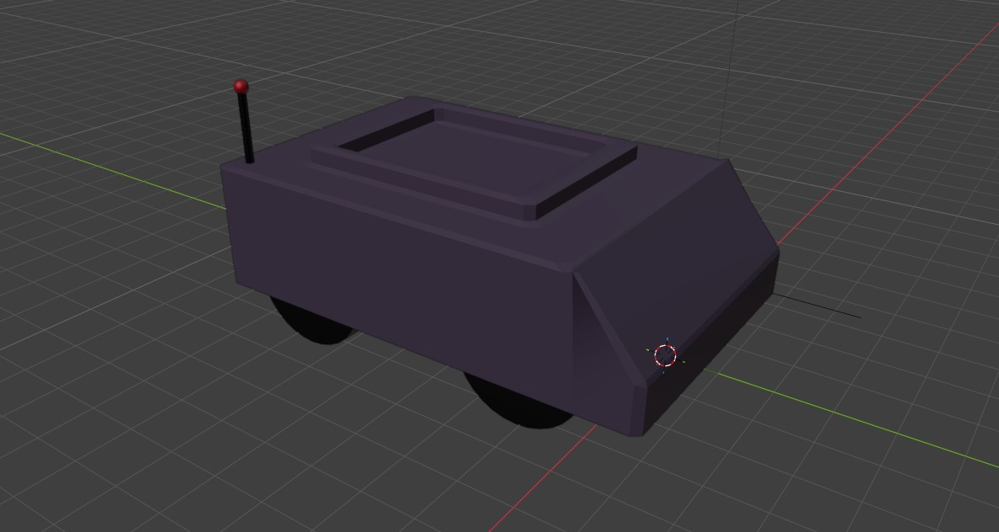
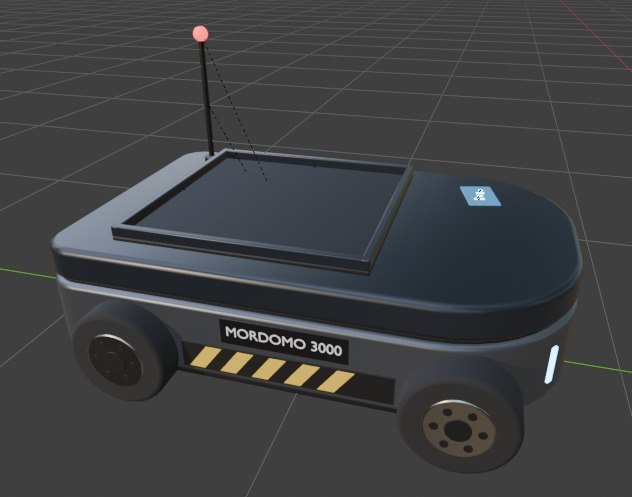
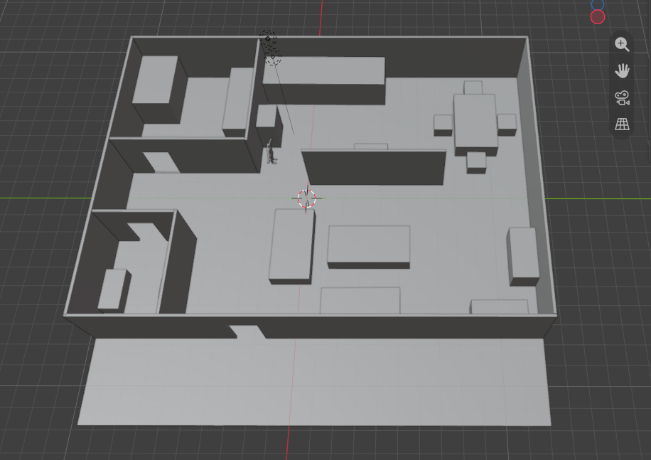
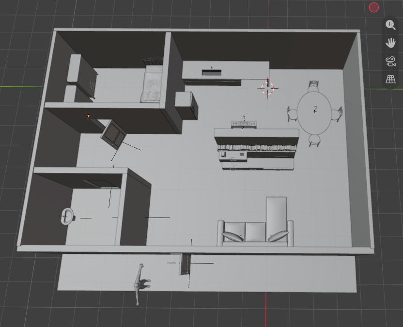
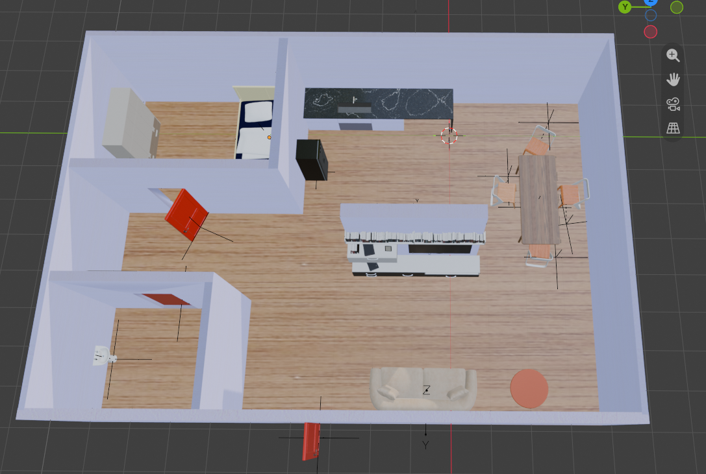
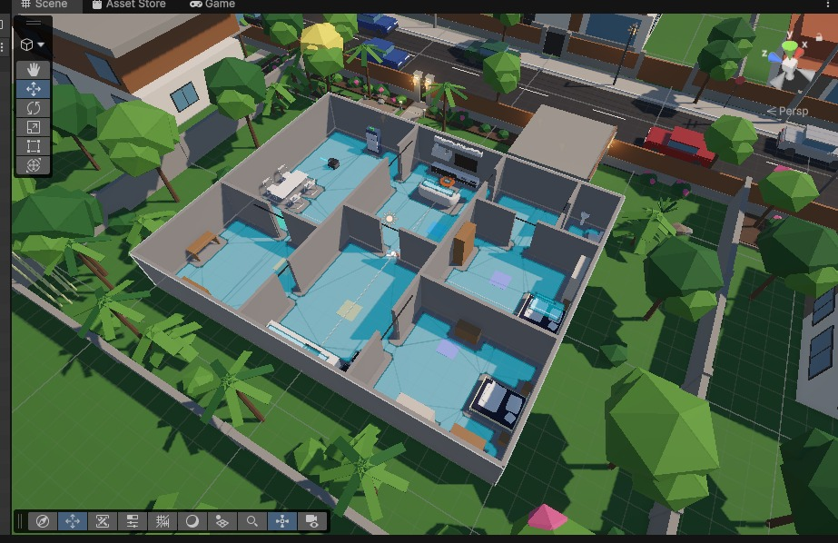
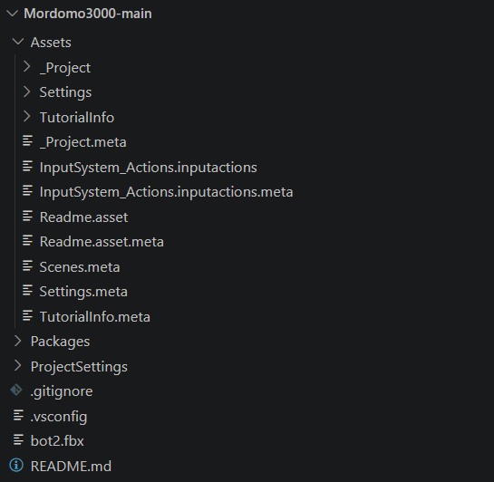

MORDOMO 3000 
=

Visão geral
=

O Mordomo 3000 é uma máquina de transporte inteligente que recebe encomendas e as leva, de forma prática e segura, até o local apropriado.

Problema: Receber uma encomenda pode ser visto como um transtorno para muitas pessoas idosas ou com deficiência, por conta do peso da mercadoria ou incapacidade física da pessoa. Além disso, o entregador também pode ser prejudicado pela demora ou impossibilidade de recebimento da entrega.

Solução: O robô fica na entrada da casa, recebe o pacote na bandeja superior e o transporta até o destino dentro da residência.

Objetivos do projeto:
 - Tornar o recebimento de encomendas mais rápido e eficiente.
 - Transportar a carga com segurança até o local correto.

Público-alvo: Indivíduos com dificuldades físicas que recebem encomendas com frequência.

Funcionalidades principais
=

O Mordomo 3000 cobre três etapas da entrega: receber, transportar e entregar.

 - Recebimento na porta: O robô aguarda na entrada da casa e recebe o pacote na bandeja superior, sem que o morador precise estar presente.
 - Transporte seguro: A carga é levada sobre a bandeja com bordas, que a mantém no lugar durante o deslocamento sobre as quatro rodas.
 - Entrega ao destino: O robô leva a encomenda até a pessoa responsável ou até o local apropriado da casa.

Modelos inicial e final do robô:
=

Fases de desenvolvimento do ambiente virtual:
=

Hierarquia de Pastas e Arquivos
=

Execução e Comandos
=
Após executar o projeto, a simulação pode ser manipulada por meio do menu visível na tela e também pelas teclas abaixo:

X  -  Cria a encomenda
T  -  Alterna a velocidade
ESPAÇO  -  Pausa
C  -   Alterna a câmera

Avaliação de segurança do protótipo de movimentação física
=

Como parte do desenvolvimento, foi realizada uma avaliação de segurança sobre o próprio protótipo de movimentação física do Mordomo 3000.
O objetivo dessa etapa foi identificar possíveis falhas no processamento de comandos e no gerenciamento do estado físico do robô, simulando situações em que entradas inválidas ou manipuladas poderiam comprometer seu funcionamento.
Foram desenvolvidos e executados nove testes automatizados, que identificaram três falhas reais. Após as correções, os mesmos testes foram executados novamente, comprovando a eficácia das alterações realizadas.
Escopo e modelo de ameaça

A avaliação teve como alvo a API pública e o estado interno do protótipo físico, considerando os seguintes componentes:
DifferentialDriveModel
KinematicDriveBody
PhysicalDriveAdapter

A premissa adotada foi considerar que qualquer elemento capaz de enviar comandos à API ou modificar diretamente o Transform do robô poderia apresentar entradas incorretas ou maliciosas.
Foram consideradas cinco superfícies principais de ataque:
Comandos de movimento: Valores de velocidade e giro.
Configuração do robô: Bitola, raio da roda, parâmetro χ e limites de movimentação.
Teleporte e reset de pose: Alterações diretas na posição e orientação do robô.
Destino enviado ao adaptador: Valores inválidos utilizados para definir o destino do robô.
Escrita externa no Transform: Modificações externas na posição e rotação do objeto.
Fora do escopo: A avaliação não contemplou rede, autenticação, controlador original ou o sistema completo. Além disso, nenhum arquivo original do projeto foi alterado durante essa fase.
Testes de segurança realizados

Foram realizados nove testes automatizados, com o objetivo de verificar a resistência do protótipo a entradas inválidas, manipulações de estado e situações extremas.
Teste
Ataque realizado
A1
Envio de comando NaN ao modelo de movimentação.
A2
Envio de comandos com valores infinitos ou excessivamente grandes.
A3
Aplicação de configurações inválidas, como bitola, raio da roda ou χ iguais a zero e limites negativos.
A4
Envio de comando NaN ao corpo físico (Rigidbody).
A5
Teleporte utilizando posições NaN ou infinitas.
A6
Envio excessivo de comandos, com 2.000 comandos por passo.
A7
Envio de destinos NaN ou infinitos ao adaptador.
A8
Execução de HardReset com pose NaN.
A9
Adulteração do Transform, com deslocamento de 10 metros e rotação de 180°.

Resultados dos testes
Na primeira execução, antes das correções, foram identificadas três falhas reais relacionadas ao processamento de valores inválidos e à integridade do estado físico do robô.
Após as alterações, os mesmos nove testes foram executados novamente.
Resultado
Antes das correções
Depois das correções
Testes aprovados
6
9
Testes reprovados
3
0
Total de testes
9
9

Resultado final: Os nove testes de segurança foram aprovados após as correções, demonstrando que as três falhas identificadas foram solucionadas.

Falhas encontradas e correções aplicadas
Durante a avaliação, foram identificadas três falhas principais:
1. Corrupção da pose por comandos NaN
O primeiro problema identificado ocorria quando o modelo recebia um comando contendo o valor NaN (Not a Number). O limitador de velocidade permitia que esse valor fosse processado, fazendo com que a pose do robô também assumisse um estado NaN. Mesmo após o recebimento de comandos válidos, o modelo não conseguia recuperar seu estado normal.
Correção aplicada: Os valores NaN passaram a ser tratados como comandos de parada segura. Além disso, passos que apresentam valores não finitos são rejeitados e contabilizados por meio do indicador RejectedCommits.
2. Aceitação de configurações inválidas
Foi identificado que o sistema aceitava parâmetros inválidos de configuração, como bitola, raio da roda ou χ iguais a zero, além de limites negativos. Essas condições poderiam provocar cálculos com resultados NaN ou infinitos, comprometendo o funcionamento do modelo físico.
Correção aplicada: Foi implementada a validação dos parâmetros de configuração. O método ApplyConfig passou a rejeitar configurações inválidas, mantendo a configuração anterior. Caso uma configuração inválida seja identificada no Inspector, o sistema utiliza os valores padrão.
3. Corrupção do estado físico por teleporte e reset inválidos
O terceiro problema estava relacionado aos métodos de teleporte e reset, que aceitavam posições e orientações contendo valores NaN ou infinitos. Isso poderia corromper simultaneamente o corpo físico, o agente e o Transform do robô.
Correção aplicada: Os métodos Teleport e HardReset passaram a validar as poses recebidas, rejeitando valores inválidos sem modificar o estado atual do robô. Além disso, ambos retornam um valor booleano (bool) para indicar se a operação foi realizada com sucesso.
Verificação das correções
Para comprovar a eficácia das alterações, os nove ataques foram implementados como testes automatizados no arquivo FaseSSegurancaTests.cs, executados no modo PlayMode da Unity.
O processo de verificação foi dividido em duas etapas:
Primeira execução: Os testes foram executados antes das correções, identificando três falhas e resultando em seis testes aprovados.
Segunda execução: Após a implementação das correções, os mesmos nove testes foram executados novamente, obtendo aprovação em todos eles.
Também foi realizada uma regressão com os testes de EditMode, na qual os 21 testes foram aprovados.
Limitações e observações
Apesar dos resultados positivos, a avaliação apresenta algumas limitações que devem ser consideradas:
O escopo foi restrito à validação de entradas e à integridade do estado do protótipo de movimentação física, não caracterizando um teste de invasão (pentest) completo.
Durante a execução combinada dos testes de PlayMode, sete testes da Fase A apresentaram falhas relacionadas a NoPath. Entretanto, quando executados isoladamente, todos foram aprovados. A causa dessa inconsistência não foi investigada.
Os testes de diagnóstico da Fase C não foram executados novamente após a implementação das correções.
Portanto, os resultados comprovam a correção das três falhas identificadas no escopo da avaliação, mas não representam uma validação completa de segurança de todo o sistema.
Arquivos modificados e adicionados
Os arquivos relacionados à avaliação de segurança estão localizados no diretório:
Assets/_Prototypes/MovimentacaoFisica/
Os principais arquivos envolvidos são:
Scripts/Runtime/DifferentialDriveModel.cs: Contém correções relacionadas ao processamento de comandos e à validação de configurações.
Scripts/Runtime/KinematicDriveBody.cs: Contém correções relacionadas à integridade do estado físico do robô.
Scripts/Runtime/PhysicalDriveAdapter.cs: Contém correções relacionadas à comunicação com o adaptador e à validação de operações.
Tests/PlayMode/FaseSSegurancaTests.cs: Contém os nove testes automatizados utilizados para avaliar a segurança do protótipo.

